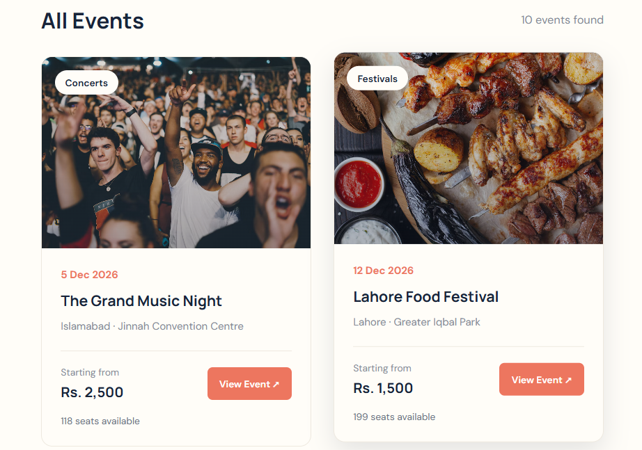
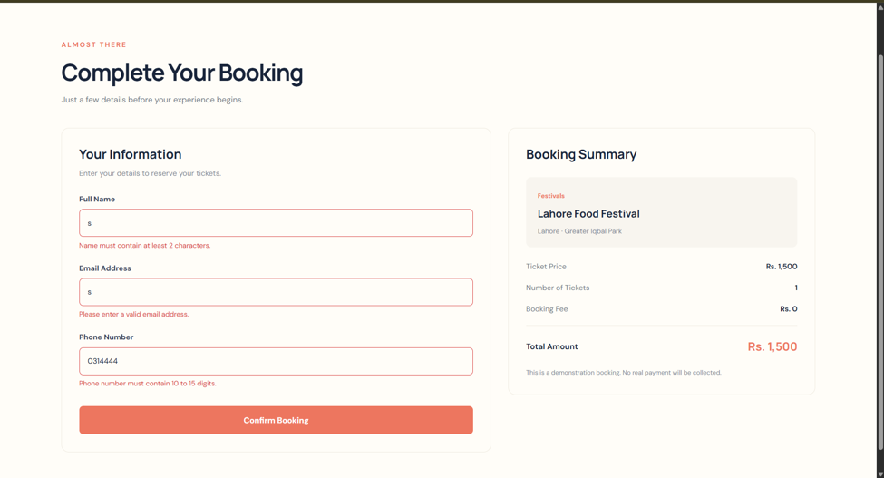
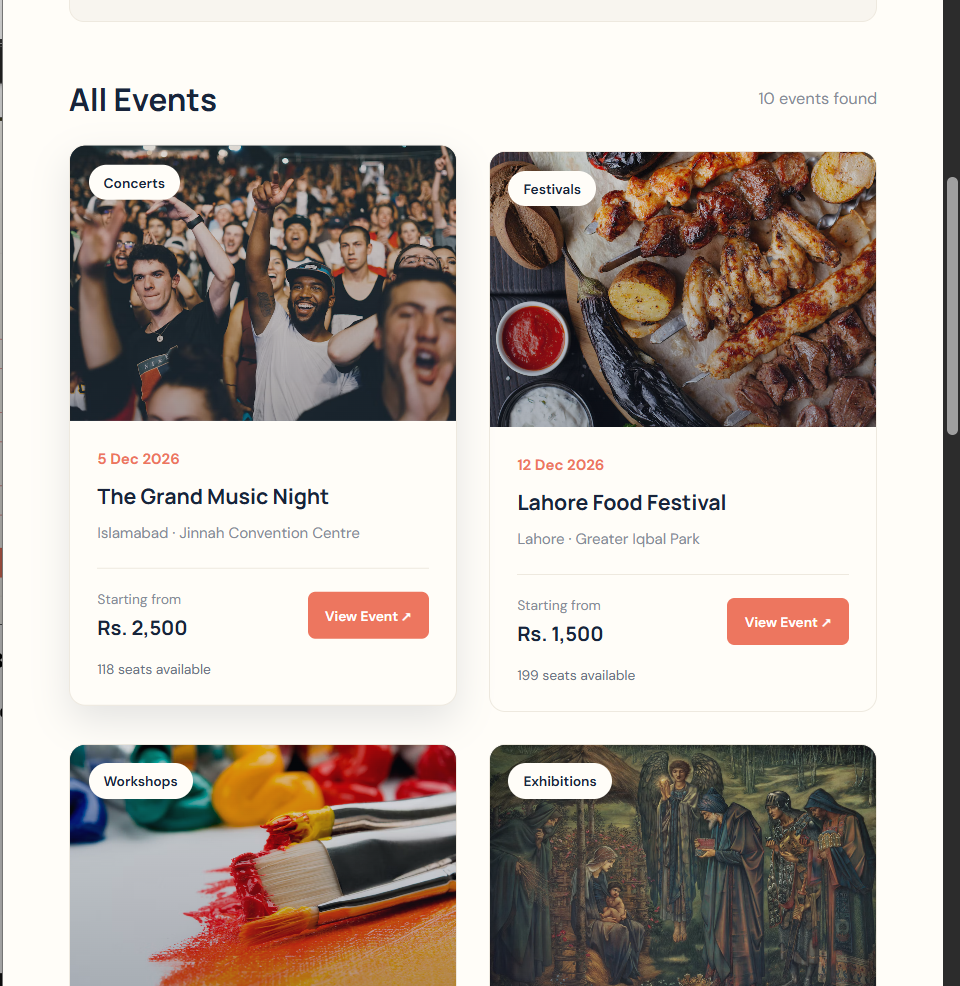
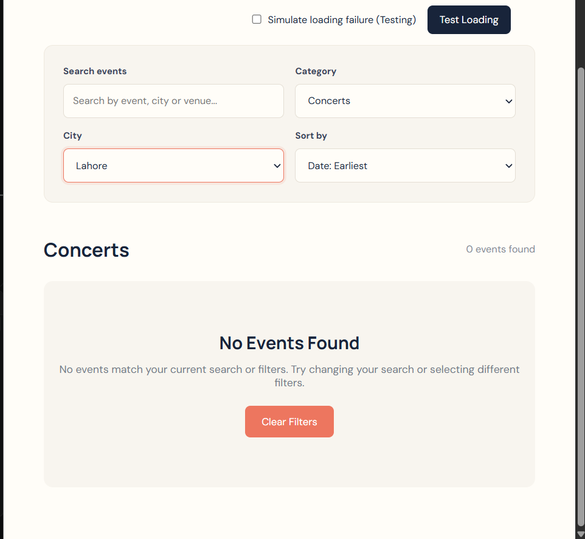

# ScenePass – Frontend Design Decisions

## Decision 1: Shared Ticket Availability

**Problem:**  
If ticket availability is not clearly shown or updated consistently, customers may select tickets without knowing whether enough seats are available.

**Reference Website:**  
https://bookkaru.com/
https://ticketwala.pk/

**Decision:**  
ScenePass uses a shared ticket inventory so the available seat count stays consistent across event cards and event detail pages. When a booking is completed, the available seats decrease. When a booking is cancelled, the seats are restored.

**Alternative:**  
Display a fixed seat count on each event card and detail page without updating it after bookings.

**Reason:**  
A shared inventory gives customers more accurate availability information and helps prevent bookings beyond the available capacity.

**Tradeoff:**  
Maintaining shared inventory requires additional JavaScript logic and synchronization with browser local storage.

**Code Location:**
- `src/utils/inventory.js`
- `src/components/EventCard.jsx`
- `src/pages/EventDetails.jsx`
- `src/pages/Booking.jsx`
- `src/pages/MyBookings.jsx`

**Evidence:**
- Screenshot:
- Steps:
  1. Open an event and note its available seats.
  2. Complete a booking.
  3. Return to the event listing and observe the updated seat count.
  4. Cancel the booking and observe the restored availability.

---

## Decision 2: Clear Booking Form Validation

**Problem:**  
Unclear form errors can make it difficult for customers to understand what information needs correction before completing a booking.

**Reference Website:**  
https://bookkaru.com/
https://ticketwala.pk/

**Decision:**  
ScenePass uses controlled form inputs and field-specific validation. The form checks the customer's name, email address, and phone number. Each invalid field displays a specific error message.

**Alternative:**  
Show one general error message at the top of the form when any input is invalid.

**Reason:**  
Field-specific feedback helps customers identify and correct mistakes without guessing which information is incorrect.

**Tradeoff:**  
Individual validation rules and error messages require additional state and form-handling logic.

**Code Location:**
- `src/pages/Booking.jsx`
- `src/pages/Booking.css`

**Evidence:**
- Screenshot:
- Steps:
  1. Open the booking page.
  2. Enter an invalid name, email, or phone number.
  3. Submit the form.
  4. Observe the specific error messages displayed beside the relevant fields.

---

## Decision 3: Clear Event Information and Empty States

**Problem:**  
When important event information is difficult to find, or when a search returns no results without useful guidance, customers may struggle to choose an event.

**Reference Website:**  
https://bookkaru.com/
https://ticketwala.pk/

**Decision:**  
ScenePass presents important event information in event cards so customers can compare available options. It also provides separate messages for an empty event dataset and searches or filters that return no matches, with a clear option to reset filters.

**Alternative:**  
Display only event titles in the listing and use the same generic message whenever no results are available.

**Reason:**  
Showing useful event information supports comparison, while distinct empty states help customers understand the situation and continue browsing.

**Tradeoff:**  
Displaying more information requires careful spacing and responsive layout adjustments, especially on smaller screens.

**Code Location:**
- `src/components/EventCard.jsx`
- `src/components/EventCard.css`
- `src/pages/Events.jsx`
- `src/pages/Events.css`

**Evidence:**
- Screenshot 1: 
- Screenshot 2: 
- Steps:
  1. Open the Explore Events page.
  2. Compare the information displayed on event cards.
  3. Search for an event that does not exist.
  4. Observe the no-results message and Clear Filters option.

---

## Summary

The three decisions improve the ScenePass booking journey by providing consistent ticket availability, clearer form validation, and better event information with helpful empty states.

These decisions aim to make event discovery and ticket booking easier for customers.